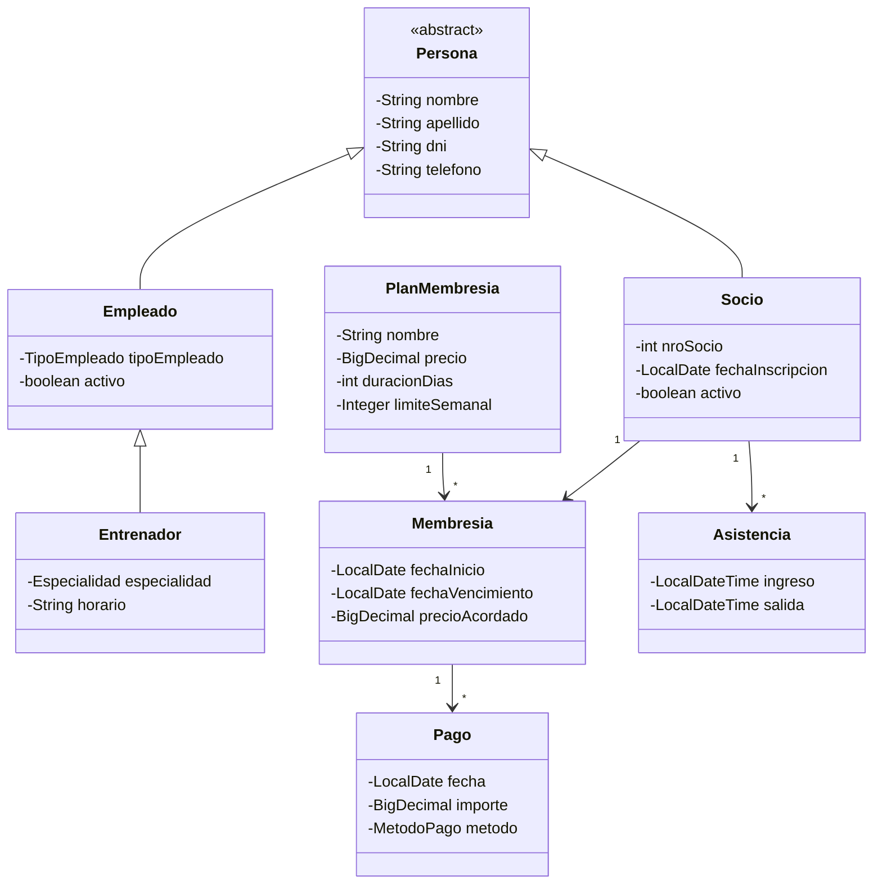

# Proyecto-Integrador Programación II
# 🏋️ Gestión de Gimnasio
 
Aplicación web de gestión para un gimnasio: socios, membresías, pagos, asistencias y personal.
 
> Tecnologías: Maven · DataNucleus JDO · Spring · Spring Boot · MVC · Thymeleaf · HTML · CSS · Bootstrap
 
> ⚠️ Los textos marcados con `COMPLETAR` dependen de decisiones técnicas que el grupo todavía tiene que cerrar (versiones, nombres de paquetes, etc.). Hay que reemplazarlos antes de la entrega.
 
---
 
## 📑 Índice
 
1. [Integrantes](#-integrantes)
2. [Descripción del problema](#-descripción-del-problema)
3. [Funcionalidades](#-funcionalidades)
4. [Reglas de negocio](#-reglas-de-negocio)
5. [Modelo de dominio](#-modelo-de-dominio)
6. [Arquitectura por capas](#-arquitectura-por-capas)
7. [Tecnologías](#-tecnologías)
8. [Requisitos previos](#-requisitos-previos-qué-tenés-que-tener-instalado)
9. [Configuración y ejecución](#-configuración-y-ejecución)
10. [Estructura del repositorio](#-estructura-del-repositorio)
11. [Datos de demostración](#-datos-de-demostración)
12. [Pruebas](#-pruebas)
13. [Solución de problemas](#-solución-de-problemas)
14. [Alcance y mejoras futuras](#-alcance-y-mejoras-futuras)
15. [Forma de trabajo del equipo](#-forma-de-trabajo-del-equipo)
---
 
## 👥 Integrantes
 
| Nombre | Rol / aporte principal |
|---|---|
| Juan Alvarez | COMPLETAR |
| Pablo Ruiz Diaz | COMPLETAR |
| Mauro Presso | COMPLETAR |
 
---
 
## 📌 Descripción del problema
 
Hoy el gimnasio registra todo en una planilla de Excel: quién es socio, qué membresía tiene, cuándo vence, qué pagó y quién trabaja en el lugar. Eso genera errores (socios con la membresía vencida que igual entran, pagos que no se encuentran, datos duplicados) y mucho trabajo manual.
 
Esta aplicación reemplaza el Excel con un sistema web que permite:
 
- Llevar el registro de **socios** y del **personal** (empleados y entrenadores).
- Administrar los **planes de membresía** (Bronce, Plata y Oro) y las **membresías contratadas** por cada socio, con sus vencimientos.
- Registrar los **pagos** y mantener su historial.
- Controlar el **ingreso y la salida** de los socios, verificando que su membresía esté vigente y que no superen el límite de visitas semanales de su plan.
---
 
## ✅ Funcionalidades
 
### Versión 1 (alcance de esta entrega)
 
| # | Funcionalidad | Descripción |
|---|---|---|
| 1 | **ABM de Socios** | Alta, baja (lógica), modificación y listado |
| 2 | **ABM de Empleados y Entrenadores** | Alta, baja (lógica), modificación y listado, con filtro por tipo |
| 3 | **Consulta de planes de membresía** | Listado de planes (Bronce, Plata, Oro) con precio, duración y límite semanal. Se usan al contratar una membresía |
| 4 | **Contratar / renovar membresía con pago** | Registra la membresía y el pago en una sola operación |
| 5 | **Registrar ingreso y salida** | Valida membresía vigente, límite semanal e ingreso abierto |
| 6 | **Búsqueda de socios** | Por nombre, apellido, DNI o número de socio |
| 7 | **Vencimientos e historiales** | Membresías vencidas o por vencer; historial de membresías, pagos y asistencias de cada socio |
 
> **¿Qué es ABM?** Alta, Baja y Modificación: crear, eliminar y editar registros desde la web (junto con el listado).
 
---
 
## 📏 Reglas de negocio
 
1. **Semana** = de lunes a domingo.
2. **Límite semanal** por plan, contando **días distintos** (varios ingresos el mismo día cuentan como uno):
   - Bronce: 2 días por semana
   - Plata: 3 días por semana
   - Oro: pase libre
3. No se permite el **ingreso** con membresía vencida ni con el límite semanal agotado.
4. No se permite registrar un **ingreso** si el socio ya tiene uno abierto (sin salida). La salida debe ser posterior al ingreso.
5. Un socio tiene **una sola membresía vigente** a la vez. Al renovar, la nueva empieza al día siguiente del vencimiento (o el mismo día si ya venció).
6. Los **importes** deben ser mayores a 0 y las **fechas** coherentes (el vencimiento es posterior al inicio).
7. El **número de socio** y el **DNI** no se pueden repetir.
8. Las **bajas son lógicas**: al dar de baja un socio o un empleado se conservan sus pagos y asistencias.
9. El **último pago** no se guarda como dato: se calcula desde el historial de pagos, para evitar datos contradictorios.
10. **Registrar el pago y crear/renovar la membresía es una sola transacción**: si falla una parte, se revierte todo.
11. El **precio acordado** se copia del plan al contratar. Si el precio del plan cambia después, las membresías anteriores no se modifican.
---
 
## 🗂️ Modelo de dominio
 

 
### Relaciones
 
| Relación | Tipo |
|---|---|
| Socio → Membresía | 1 a muchos (historial de membresías) |
| Socio → Asistencia | 1 a muchos |
| PlanMembresia → Membresía | 1 a muchos |
| Membresía → Pago | 1 a muchos |
 
### Herencia
 
`Persona` es la clase base (nombre, apellido, DNI, teléfono). `Socio` y `Empleado` heredan de ella, y `Entrenador` hereda de `Empleado`.
Como el entrenador se identifica por su clase, el enum `TipoEmpleado` solo tiene `RECEPCIONISTA` y `LIMPIEZA`.
Estrategia de herencia de JDO elegida: **COMPLETAR** (y el porqué).
 
### Enumeraciones
 
- `TipoEmpleado`: RECEPCIONISTA, LIMPIEZA
- `Especialidad`: MUSCULACION, CROSSFIT, AEROBOX, CALISTENIA, LIBRE
- `MetodoPago`: EFECTIVO, TRANSFERENCIA, TARJETA
### Tipos de datos
 
- Importes: `BigDecimal`
- Fechas de membresía y de pago: `LocalDate`
- Ingreso y salida: `LocalDateTime`
---
 
## 🧱 Arquitectura por capas
 
| Capa | Responsabilidad | Ejemplo |
|---|---|---|
| **Dominio** | Entidades, relaciones y comportamiento del modelo | `Socio`, `Membresia`, `Pago` |
| **Repositorio** | Consultas y persistencia con JDO. Sin reglas de negocio | `SocioRepository` |
| **Servicio** | Reglas de negocio, validaciones y transacciones | `MembresiaService.contratar()`, `AccesoService.registrarIngreso()` |
| **Controlador** | Recibe las solicitudes del navegador y prepara los datos del `Model` | `SocioController` |
| **Vistas** | Formularios y listados con Thymeleaf y Bootstrap. No acceden a los repositorios | `socios/listado.html` |
 
### Recorrido de una operación
 
Ejemplo: **registrar el pago de una renovación**.
 
```
Formulario (Thymeleaf)
   → PagoController / MembresiaController
      → MembresiaService  (valida y abre la transacción)
         → MembresiaRepository / PagoRepository  (DataNucleus JDO)
            → Base de datos
      ← resultado
   ← Model
← Vista con mensaje de confirmación o de error
```
 
### Manejo de la persistencia
 
- Hay **una sola** `PersistenceManagerFactory` para toda la aplicación (administrada por Spring).
- Cada operación usa **su propio** `PersistenceManager`, que se cierra siempre al terminar. No se comparte entre solicitudes.
- Las operaciones de escritura se ejecutan dentro de una **transacción** con `commit` y `rollback`.
---
 
## 🛠️ Tecnologías
 
| Tecnología | Para qué se usa |
|---|---|
| **Java** (COMPLETAR versión) | Lenguaje |
| **Maven** | Construcción del proyecto y manejo de dependencias |
| **DataNucleus JDO** | Persistencia de objetos en la base de datos |
| **Spring / Spring Boot** (COMPLETAR versión) | Inyección de dependencias y arranque de la aplicación web |
| **Spring MVC** | Controladores y arquitectura MVC |
| **Thymeleaf** | Motor de plantillas para las vistas |
| **HTML, CSS y Bootstrap** | Interfaz de usuario |
| **MySQL** (COMPLETAR versión) | Base de datos |
| **JUnit** | Pruebas |
| **Git y GitHub** | Control de versiones |
 
---
 
## 💻 Requisitos previos (qué tenés que tener instalado)
 
| Herramienta | Para qué | Cómo verificar que está instalada |
|---|---|---|
| **JDK de Java** (versión: COMPLETAR) | Compilar y ejecutar la app | `java -version` |
| **Apache Maven** | Compilar y manejar dependencias | `mvn -version` |
| **MySQL Server** (y opcionalmente MySQL Workbench) | Base de datos | `mysql --version` |
| **Git** | Clonar el repositorio | `git --version` |
| **Un navegador web** | Usar la aplicación | — |
| **Un IDE** (IntelliJ IDEA, Eclipse, VS Code, etc.) | Opcional, para editar el código | — |
 
Enlaces de descarga:
 
- JDK (por ejemplo, Eclipse Temurin): <https://adoptium.net>
- Maven: <https://maven.apache.org/download.cgi>
- MySQL Community: <https://dev.mysql.com/downloads/>
- Git: <https://git-scm.com/downloads>
> Verificá que `java -version` y `mvn -version` muestren la misma versión de Java. Si Maven usa otra, revisá la variable de entorno `JAVA_HOME`.
 
---
 
## 🚀 Configuración y ejecución
 
### 1. Clonar el repositorio
 
```bash
git clone https://github.com/juanpi-alvarez-am25/Proyecto-Integrador.git
cd Proyecto-Integrador
```
 
### 2. Preparar la base de datos
 
1. Asegurate de que MySQL esté corriendo.
2. Abrí una consola de MySQL (o MySQL Workbench) y ejecutá el script de creación:
```bash
   mysql -u TU_USUARIO -p < db/schema.sql
```
 
   *(COMPLETAR: confirmar el nombre y la ubicación del script una vez creado.)*
 
3. El script crea la base `gimnasio` (COMPLETAR si usan otro nombre).
4. Opcional: cargar los datos de demostración (ver [Datos de demostración](#-datos-de-demostración)).
### 3. Configurar la conexión
 
1. Copiá el archivo de ejemplo:
```bash
   cp src/main/resources/application.properties.example src/main/resources/application.properties
```
 
   En Windows (PowerShell): `Copy-Item src/main/resources/application.properties.example src/main/resources/application.properties`
 
2. Editá `application.properties` y completá tus datos de conexión. Ejemplo (las claves exactas pueden variar según cómo se haya integrado JDO):
```properties
   javax.jdo.option.ConnectionURL=jdbc:mysql://localhost:3306/gimnasio
   javax.jdo.option.ConnectionDriverName=com.mysql.cj.jdbc.Driver
   javax.jdo.option.ConnectionUserName=TU_USUARIO
   javax.jdo.option.ConnectionPassword=TU_CONTRASEÑA
```
 
> 🔒 **Nunca subas `application.properties` con tu contraseña real.** Está incluido en `.gitignore`. Solo se versiona el archivo `.example`.
 
### 4. Compilar
 
```bash
mvn clean install
```
 
Este paso también ejecuta el **enhancer de DataNucleus** (plugin de Maven), necesario para que las clases persistentes funcionen con JDO.
 
### 5. Ejecutar la aplicación
 
```bash
mvn spring-boot:run
```
 
O bien, usando el JAR generado:
 
```bash
java -jar target/NOMBRE-DEL-ARCHIVO.jar
```
 
*(COMPLETAR el nombre del JAR según el `artifactId` y la versión del `pom.xml`.)*
 
### 6. Usar la aplicación
 
Abrí el navegador en: **<http://localhost:8080>**
 
> Si cambian el puerto en la configuración, actualizá esta dirección.
 
### Verificar que los datos persisten
 
1. Creá un socio desde la web.
2. Detené la aplicación (`Ctrl + C`).
3. Volvé a ejecutarla.
4. El socio tiene que seguir apareciendo en el listado.
---
 
## 📁 Estructura del repositorio
 
```
Proyecto-Integrador/
├── pom.xml
├── README.md
├── .gitignore
├── db/
│   ├── schema.sql                      # creación de la base
│   └── datos_demo.sql                  # datos de demostración
└── src/
    ├── main/
    │   ├── java/<paquete-base>/        # COMPLETAR paquete
    │   │   ├── dominio/                # entidades y enums
    │   │   ├── repositorio/            # acceso a datos (JDO)
    │   │   ├── servicio/               # reglas de negocio
    │   │   └── controlador/            # controladores MVC
    │   └── resources/
    │       ├── templates/              # vistas Thymeleaf
    │       ├── static/                 # CSS, imágenes
    │       ├── application.properties.example
    │       └── (application.properties — local, no se versiona)
    └── test/
        └── java/<paquete-base>/        # pruebas
```
 
---
 
## 🎲 Datos de demostración
 
El archivo `db/datos_demo.sql` carga socios, personal, membresías, pagos y asistencias de ejemplo para poder probar el sistema sin cargar todo a mano.
 
```bash
mysql -u TU_USUARIO -p gimnasio < db/datos_demo.sql
```
 
Los planes **Bronce, Plata y Oro** se cargan automáticamente al iniciar la aplicación por primera vez (COMPLETAR si se cargan por script).
 
---
 
## 🧪 Pruebas
 
```bash
mvn test
```
 
Cubren las reglas principales: membresía vencida, límite semanal, ingreso duplicado y reversión del pago ante error.
 
---
 
## 🩺 Solución de problemas
 
| Problema | Posible causa y solución |
|---|---|
| `java: command not found` o versión incorrecta | JDK no instalado o `JAVA_HOME` apuntando a otra versión. Revisá `java -version` y la variable `JAVA_HOME` |
| `mvn: command not found` | Maven no está instalado o no está en el `PATH` |
| `Communications link failure` / no conecta a MySQL | MySQL no está corriendo, o la URL, el usuario o la contraseña son incorrectos |
| `Access denied for user` | Usuario o contraseña incorrectos, o el usuario no tiene permisos sobre la base `gimnasio` |
| `Unknown database 'gimnasio'` | Falta ejecutar el script de creación de la base |
| `Port 8080 was already in use` | Otro programa usa el puerto. Cerralo o cambiá el puerto de la aplicación |
| Error de que la clase *no está enhanced* / *not persistence-capable* | No se ejecutó el enhancer de DataNucleus. Corré `mvn clean compile` y revisá la configuración del plugin en el `pom.xml` |
| Cambié el código y no se refleja | Detené la app y volvé a ejecutar `mvn clean install` |
 
---
 
## 🔭 Alcance y mejoras futuras
 
**Opcionales (se evalúan si la versión 1 está completa):**
 
- **Máquinas**: registro de máquinas, su estado y mantenimientos.
- **Clases e inscripciones**: clases con horario y cupo (no incluido en el alcance inicial).
- **Tiempo límite dentro del gimnasio** según el plan contratado.
**Para etapas posteriores:**
 
- Rutinas de entrenamiento y entrenador personal
- Sueldos del personal
- Sucursales
- Tienda (ropa, suplementos, bebidas) y proveedores
- Recargo por tarjeta
- Notificación por email de vencimientos
---
 
## 🤝 Forma de trabajo del equipo
 
- Rama principal: `main` (siempre tiene que compilar y ejecutar).
- Una rama por tarea: `feature/<id-de-tarjeta>-<descripcion>` (por ejemplo, `feature/N2-contratar-membresia`).
- Commits chicos y con mensajes claros.
- Las tareas se organizan en Projects de GitHub.
- Antes de unir una rama a `main`, se compila y se prueba que la aplicación arranque.
---
 
*Proyecto Integrador — Programación II — IFES, Educación Superior.*
